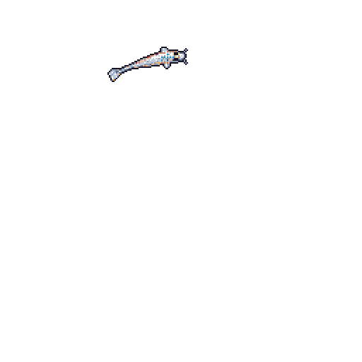

### Armaan Seth

Fourteen, Gainesville, Florida. I debate, I coach, and I build the websites for both.

I run **[MITEZ](https://mitez.org)**, free one-to-one mentorship in whatever you want to learn, and I'm head coach of **[Skeptical](https://skeptical.pages.dev)**, an independent Lincoln-Douglas team. Most of what I write is for the people in those two rooms.

The fish is mine. [git-koi](https://github.com/yalongwastaken/git-koi) redraws it every night from my public activity, so it gets bigger when I ship and sulks when I don't.

 

<picture><source media="(prefers-color-scheme: dark)" srcset="assets/stats-dark.svg" /></picture>


<picture><source media="(prefers-color-scheme: dark)" srcset="assets/streak-dark.svg" /></picture>
<picture><source media="(prefers-color-scheme: dark)" srcset="assets/hours-dark.svg" /></picture>

<picture><source media="(prefers-color-scheme: dark)" srcset="assets/year-dark.svg" /></picture>

<picture><source media="(prefers-color-scheme: dark)" srcset="assets/langs-dark.svg" /></picture>

<picture><source media="(prefers-color-scheme: dark)" srcset="assets/commit-dark.svg" /></picture>

<a href="https://github.com/wowneutral/spread"><picture><source media="(prefers-color-scheme: dark)" srcset="assets/map-dark.svg" /></picture></a>

<picture><source media="(prefers-color-scheme: dark)" srcset="assets/vocab-dark.svg" /></picture>
<picture><source media="(prefers-color-scheme: dark)" srcset="assets/weekdays-dark.svg" /></picture>

<picture><source media="(prefers-color-scheme: dark)" srcset="assets/sites-dark.svg" /></picture>
<picture><source media="(prefers-color-scheme: dark)" srcset="assets/tournament-dark.svg" /></picture>

#### Things I've built

<!-- WORK:START -->
| Project | What it is | Live |
| --- | --- | --- |
| **[Spread](https://wowneutral.github.io/spread/)** | Free, open-source card cutting and flowing for debaters on Chromebooks. A Verbatim alternative that works offline. | [pushed 2 months ago](https://github.com/wowneutral/spread) · 2 stars |
| **[Skeptical](https://skeptical.pages.dev)** | The team's site, with a Discord sign-in portal for coaches. React, GSAP, Cloudflare Pages and D1. |  |
| **[MITEZ](https://mitez.org)** | The nonprofit's site. React and Vite. | [pushed 3 months ago](https://github.com/wowneutral/mitez-site) · 1 star |
| **[A Living World](https://armaanseth.pages.dev)** | My portfolio, built as one scrolling three.js scene. |  |
| **[Rogue](https://clauderogue.netlify.app)** | How far an AI can carry a build on its own, and where the seams show. |  |
<!-- WORK:END -->

#### Writing

<a href="https://doi.org/10.5281/zenodo.23652238"><picture><source media="(prefers-color-scheme: dark)" srcset="assets/paper-dark.svg" /></picture></a>

Also on [PhilArchive](https://philarchive.org/rec/SETTOQ) and [Google Scholar](https://scholar.google.com/citations?user=LKoj8VwAAAAJ). Two WD Awards Favourites, for [my portfolio](https://wdawards.com/web/a-living-world) and [mitez.org](https://wdawards.com/web/make-it-easy).

#### Lately

<!-- ACTIVITY:START -->
2 days ago — pushed 1 commit to [skeptical-draft2](https://github.com/wowneutral/skeptical-draft2) 
4 days ago — pushed 1 commit to [skeptical-draft2](https://github.com/wowneutral/skeptical-draft2) 
5 days ago — pushed 1 commit to [skeptical-draft2](https://github.com/wowneutral/skeptical-draft2) 
5 days ago — created a branch in [skeptical-draft2](https://github.com/wowneutral/skeptical-draft2) 
29 days ago — starred [ECHO-Design-Studio](https://github.com/wowneutral/ECHO-Design-Studio) 
<!-- ACTIVITY:END -->

#### Elsewhere

[armaanseth.pages.dev](https://armaanseth.pages.dev) · [founder@mitez.org](mailto:founder@mitez.org) · [Google Scholar](https://scholar.google.com/citations?user=LKoj8VwAAAAJ)

Every box on this page is drawn by <a href="scripts/widgets.py">one small script</a> and redrawn every hour by a GitHub Action. No third-party stats services.
